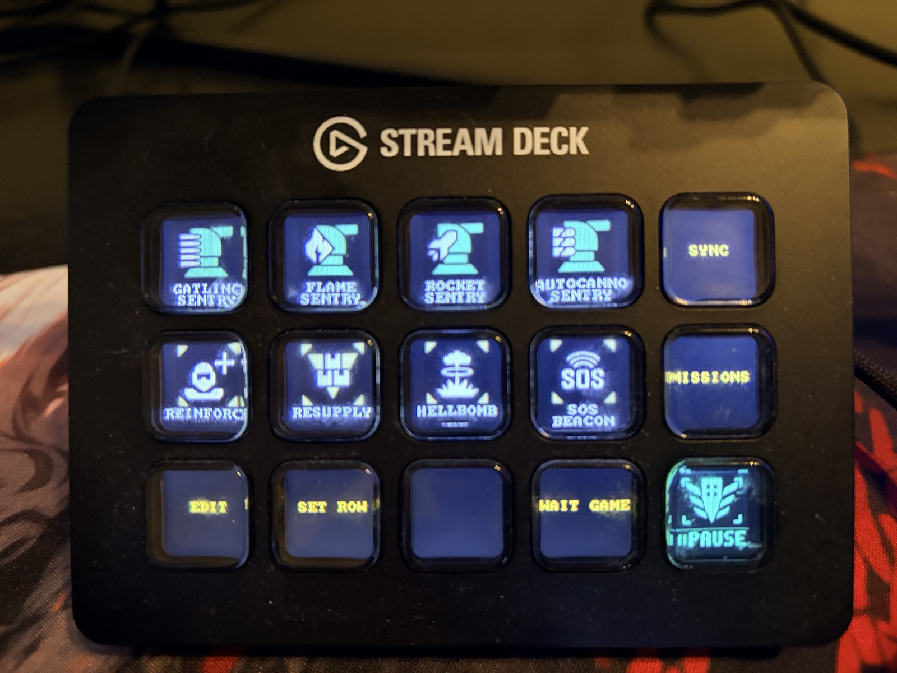
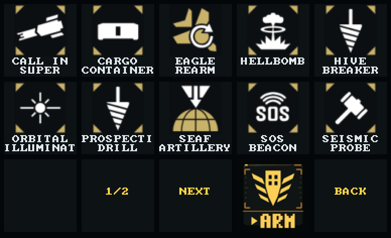

# HellDeck

**Why:** When your squad needs Reinforce, every second counts. Tap one key and HellDeck enters the stratagem code for you. You still aim and throw.


HellDeck turns an **Elgato Stream Deck MK.2** into a Helldivers 2 stratagem panel on Linux. Your four equipped stratagems sit on the top row, with Reinforce, Resupply, Hellbomb and SOS Beacon right below.

**Matthew Rogers** · [@matthewrogers on X](https://x.com/matthewrogers)

[Quick start](#quick-start) · [Device access](#device-access) · [First dive](#first-dive) · [Offline verification](#offline-verification) · [Troubleshooting](#troubleshooting)



## Quick start

The supported setup is **x86-64 Linux with Hyprland**, a local Wayland session and one 15-key MK.2 (`0fd9:0080`). Omarchy and Arch with Hyprland use the same steps. Other Linux distributions need the equivalent tools below. KDE, GNOME, X11 and other Stream Deck models do not have a live-game backend here. You can preview the panel without the game or a deck.

| What you want to do | What the host needs (Arch package names) |
| --- | --- |
| Run the panel and Sync | `hyprland`, `grim`, `slurp`, `psmisc` (`fuser`), `coreutils` (`timeout`), `systemd-libs` (`libudev`), glibc and the GCC runtime |
| Use the launcher and tray | A systemd user session, local session D-Bus, `desktop-file-utils`, `libnotify`; a StatusNotifier tray host to see the icon |
| Build from source | An installed Rust toolchain with Cargo (tested with 1.98.1), a C toolchain, `pkg-config` and libudev headers. On Arch: `rust` or an existing rustup toolchain, `base-devel`, `systemd-libs` |

1. **Copy or unpack the complete project** into a directory you will keep, then open a terminal there. Keep `.cargo/`, `vendor/` and `assets/` with it. The project supplies the Rust crates and artwork; it does not install OS packages, Rust, Steam or the game. On an air-gapped machine, provision missing host packages and their dependencies from trusted local media first.
2. **Build or use the included executable.** The offline x86-64 bundle contains `target/release/helldeck`; skip the build for that bundle. From a source-only copy, run:

   ```sh
   cargo build --release --frozen
   ```

3. **Try it without sending input**, then check the hardware. Close other deck managers and stop any running HellDeck instance before `doctor`.

   ```sh
   ./target/release/helldeck layout missions
   ./target/release/helldeck dry-run hellbomb
   ./target/release/helldeck doctor
   ```

   `doctor` should find the MK.2 and report `/dev/uinput writable: true`. An unfocused game is fine at this step. If access fails, see [Device access](#device-access).

4. **Install the launcher as your desktop user:**

   ```sh
   ./tools/install-desktop
   ./desktop/helldeck-launch
   ```

   On Omarchy you can also press **Super + Space**, type **HellDeck** and select the gold pod. The installer links to this folder, so don't move it afterward. The menu entry needs `~/.local/bin` on the launcher's `PATH`; the direct launcher command above does not. Both launch the same `helldeck.service`, paused, without enabling autostart. There is no separate app window. Quit from the tray or run `systemctl --user stop helldeck.service`.

## Device access

Run HellDeck as your normal desktop user. If `doctor` already reports writable access, **skip this section**. If `/dev/uinput` is missing, load the kernel module with `sudo modprobe uinput`. For a permission error on a systemd/logind desktop, inspect [the optional udev rules](desktop/70-helldeck.rules) before installing them:

```sh
sudo install -m 0644 desktop/70-helldeck.rules /etc/udev/rules.d/70-helldeck.rules
sudo udevadm control --reload-rules
sudo udevadm trigger --action=add --subsystem-match=misc --sysname-match=uinput
```

Unplug and reconnect the deck, then run `doctor` again from your active local session. The rules grant the active seat access to the matching Elgato HID device and to `/dev/uinput`. The latter permits **seat-wide keyboard input**; grant it only on a trusted desktop. Don't make all HID devices world-writable or run the panel with `sudo`.

## First dive

| Loadout 1 | Loadout 2 | Loadout 3 | Loadout 4 | Sync |
| --- | --- | --- | --- | --- |
| Reinforce | Resupply | Hellbomb | SOS Beacon | Missions |
| Edit | Set Row | — | Status | Arm / Pause |

1. **Match your game bindings.** The default is **Home (Press) + arrow keys**. If you use **Left Ctrl (Hold) + WASD**, set `"preset": "ctrl-wasd"` in `${XDG_CONFIG_HOME:-~/.config}/helldeck/config.json` before launching. A new file can contain just `{"preset":"ctrl-wasd"}`; if it exists, keep your saved slots and row. HellDeck doesn't change game settings.
2. **Sync your loadout.** With your four equipped icons visible in-game, press **Sync** and drag tightly around your row. Leave out names, boosters and teammates. Later syncs reuse the box. Use **Set Row** after moving your row or changing resolution or HUD scale. `Esc` cancels selection.
3. **Sync picks the highest match.** Four distinct matches update the deck together. A small lead or low score alone won't send you to Review. A weak match can be wrong; use **Edit** to correct it. An unreadable slot, unresolved exact tie, conflicting evidence, or duplicate selection still opens Review. Tap a slot and press **Apply**, or **Cancel** to keep your loadout. **Use Found** takes only the recognized slots for this session without overwriting the saved profile.
4. **Arm on the physical deck.** **WAIT GAME** means armed but not sending keys; **READY** means Helldivers 2 is focused. Presses outside the game are discarded, not queued. **Pause** stops input. A restart or reconnect starts paused. Focus is checked before each key-down, but Linux input is seat-wide: a focus switch between the check and the key-down is still possible.

**If Sync keeps missing the same icon:** correct the slots in Review, then press **Teach** instead of **Apply**. Both save the loadout. Teach also remembers compact fingerprints for the slots you explicitly picked from that scan; Apply, Cancel, manual Edit and automatic matches never train it. Teach appears when all four slots are filled and at least one picked icon has enough detail to learn. Future scans use a learned icon only on a close match; conflicting labels go back to Review. No screenshot is saved. To forget the fingerprints, stop HellDeck, remove `${XDG_CONFIG_HOME:-~/.config}/helldeck/hud-v1.json`, and start it again. This leaves the loadout and calibration intact.

**Native icon references (optional):** Sync can use the game's own icon drawings alongside the bundled artwork. Put locally verified, square PNGs (24–512 px, named by loadout ID, e.g. `las-44-nova.png`) in `${XDG_CONFIG_HOME:-~/.config}/helldeck/native-icons/`. Restart HellDeck to load them. These files affect recognition only, not what the deck displays. Missing or invalid files don't disable the bundled references. To undo, move the directory aside and restart. Don't distribute the extracted game artwork.

**Rebuild the full HUD bank from your own installation (Steam build `26568081`):** use Filediver v0.7.68 to export archive `6a3eecfddce28fe8` as textures (`--archives 6a3eecfddce28fe8 --types texture --texture-format png`). Run `python3 tools/extract_hud_refs.py /path/to/texture-export /private/new-pack` (Pillow and NumPy), copy `new-pack/icons/` to `native-icons/hud/`, and restart. The extractor checks the decoded pixels against `tools/hud_texture_keys.csv` before assigning an ID. The 95 verified textures match their shared-atlas regions; the red and green texture channels are masks for the colored body and the light detail, not display colors. Gunner has two rounds above the vehicle, Supply has three boxes, and Incinerator has a flame. Meltagun has a hollow energy bolt.

The older vector pack can coexist in the parent `native-icons/` directory. Export `content/ui/shared/resources/generated_icons/stratagem_icons.xaml` (`--xaml-format xaml`), then run `python3 tools/extract_native_refs.py /path/to/stratagem_icons.xaml /private/vector-pack`. It covers 92 entries. The Gunner/Supply alias and Meltagun placeholder belong to this dictionary, **not** the HUD texture archive; don't use them as HUD references.

Sync looks for the four straight sides of a slot frame before comparing the icon inside. It doesn't blindly crop every slot or assume the previous loadout. It runs locally on the CPU; no model download, Python service or GPU is needed. To test a row without applying it, run `./target/release/helldeck recognize cropped-row.png`.

**Missions** has 12 fixed shortcuts across two pages. Sync changes only the four loadout slots. The mission Hellbomb and equippable Portable Hellbomb are different entries. The game decides availability and cooldowns; HellDeck doesn't read game memory or interact with anti-cheat. Check the game's rules before using macros.



## Offline verification

**Sync accuracy:** On the same 380 rendered HUD slots (95 icons from game build `26568081`, each at four combinations of size, position, brightness and blur), the initial release (`4031adf`) correctly identified **220/380 (57.9%)** and sent 160 to Review. With the local native reference packs installed, the updated matcher identified **380/380 (100%)** with no wrong picks on that set. These are renders of the reference art, not unseen gameplay; the highest-scoring candidate can still be wrong in a live scan.

HellDeck makes no HTTP or HTTPS requests. It reads the catalog, key art, bitmap font and tray image from the executable. Sync captures only the selected row and matches it in memory; it neither saves nor uploads screenshots. The desktop launcher also restricts the service and its children to **Unix and kernel netlink sockets**. This leaves Wayland, D-Bus and device discovery working without IPv4 or IPv6 sockets. The restriction applies to HellDeck, not to Steam or Helldivers 2. Running the raw binary directly does not install the launcher's systemd restriction.

| Local data | Where to inspect it |
| --- | --- |
| 109 supported entries: 95 loadout, 12 mission, 2 utility | [Catalog](assets/catalog.json) and [72×72 icon atlas](assets/atlas.png). Each entry has a nonblank tile; the two drill missions share artwork. This is a catalog snapshot, not every stratagem in the game. |
| Rebuild inputs | [111 source SVGs](assets/source/icons/), [input table](assets/source/stratagems.md), [reviewed additions](assets/catalog-overlay.json). No upstream checkout required. |
| Launcher, tray, Arm and Pause | [Brand artwork](assets/brand/). The desktop installer links the local SVG and PNG; there are no remote badges or images in this README. |
| Linux build dependencies | [Local Cargo registry](vendor/registry/) and [Cargo configuration](.cargo/config.toml). The crate archives match `Cargo.lock`; Cargo fails offline if files are missing. URLs in the lockfile, credits and source notes are identifiers or links, not runtime fetches. |

To repeat the build check on Linux with unprivileged user namespaces enabled, start in the project root with Rust already installed:

```sh
check=$(mktemp -d)
unshare -Urn env CARGO_HOME="$check/cargo" CARGO_TARGET_DIR="$check/target" cargo build --release --frozen
unshare -Urn env CARGO_HOME="$check/cargo" CARGO_TARGET_DIR="$check/target" cargo test --all-targets --frozen
```

This uses a fresh cache and build directory in a network namespace with no external route. No deck is required. To inspect the running desktop unit's socket policy, use `systemctl --user show helldeck.service -p RestrictAddressFamilies`. Expect `AF_UNIX` and `AF_NETLINK` only (the order may differ). A unit started before this policy was installed needs to be stopped and launched again.

To make a bundle for another x86-64 GNU/Linux desktop, run `./tools/package-linux`. It writes a `.tar.gz` with the binary, sources, local crates and artwork, plus a `.sha256` file, under `dist/`. Transfer both files, run `sha256sum -c helldeck-*-x86_64-linux.tar.gz.sha256` in the destination directory containing that one release, then extract the archive and follow the quick start. The checksum checks the copy, not the publisher's identity.

For artwork maintenance, `python3 tools/import_assets.py` rebuilds the catalog and atlas; `python3 tools/build_arm_keys.py` rebuilds the Arm/Pause artwork. Both read the bundled inputs and write into `assets/`. Only these maintenance commands require Pillow and `rsvg-convert` (Arch: `python-pillow`, `librsvg`).

## Troubleshooting

| Symptom | What to check |
| --- | --- |
| MK.2 missing or busy | Connect one MK.2. Close competing deck managers; don't run a second controller alongside the service. |
| **WAIT GAME** never changes | Check `hyprctl -j activewindow` with the game focused. The accepted classes are `steam_app_553850` and `helldivers2.exe` (case-insensitive). |
| Sync misses a slot | Try **Set Row**, then **Edit** if needed. `journalctl --user -u helldeck.service` shows candidate scores and the decision, not screenshot pixels. Tests use rendered fixtures; matching on your particular HUD is not guaranteed. |
| Launcher starts but no tray icon appears | Check `systemctl --user status helldeck.service`. A desktop without a StatusNotifier host can still run the physical panel. |
| Prebuilt binary reports a missing library or glibc version | Build from the included source on that machine. The binary is for x86-64 GNU/Linux, not musl or ARM. |

For a hardware-free check, run `./target/release/helldeck preview missions.png missions`. `catalog` lists IDs and codes; `recognize cropped-row.png` runs the matcher on your own cropped PNG without changing your profile.

## Credits and support

HellDeck is an independent fan tool by **Matthew Rogers** ([@matthewrogers](https://x.com/matthewrogers)). For a bug report, include the output of `./target/release/helldeck --version`, your compositor, deck model and failing command. Don't include game screenshots or personal config unless needed.

The [source notes](assets/SOURCES.md) credit the community icon artists and input tables. Bundling the artwork does not grant redistribution rights to game art; third-party dependencies retain their own licenses. HellDeck is not affiliated with Arrowhead, Sony or Elgato.
